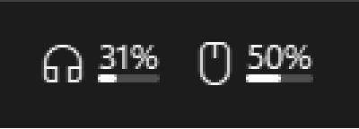

# Battery

The battery level of your wireless mouse, headset, keyboard and controller, right on the Windows
taskbar, in about 4 MB of memory.

A lean fork of **[BatteryHub](https://github.com/krisgfx9/Wireless-Device-Battery-Monitor)** by
[KrisGFX](https://github.com/krisgfx9) and its contributors, whose work nearly all of this is. If it
helps you, please [support the original](https://ko-fi.com/krisgfx).

## Download

**[Download Battery for Windows](https://github.com/ahizechi/Battery/releases/latest)**, then run the
`BatteryHub-Setup` installer from that page. It needs no administrator rights and keeps itself up to date.

Windows 10 or 11. If Windows shows a blue "protected your PC" box, choose **More info → Run anyway**.

## What it does

- **Battery on the taskbar.** Each device shows its percentage with a thin level bar underneath: green
  while charging, red when low.
- **No vendor software.** It talks to the devices directly: Logitech, Razer, SteelSeries, Corsair, HyperX,
  WLMouse, PlayStation and Xbox controllers, AirPods and Galaxy Buds, and [many more](docs/devices.md).
- **Low-battery alerts**, with a threshold you can set per device.
- **Hardware readings, if you want them.** CPU, GPU, RAM and VRAM usage and GPU and SSD temperatures,
  next to the batteries. Off by default.
- **Small and quiet.** Anything you switch off is not read at all, and it pauses hardware readings while
  the screen is off.

## Get started

1. Install it. It starts with Windows and sits next to the clock.
2. Right-click it to show, hide or reorder devices, choose what it reads, and turn options on or off.
3. Device missing? Run `BatteryHub.exe --dump` and
   [report it to BatteryHub](https://github.com/krisgfx9/Wireless-Device-Battery-Monitor/issues/new),
   where new devices are added for everyone.

## How it differs from BatteryHub

Hardware readings and the level bar are added; battery history is removed; anything switched off stops
being read; updates come only from this repository and must be signed with its own key. The app still
calls itself BatteryHub.

## More

- [Guide](docs/guide.md): display options, alerts, updates, command line, building, Linux, translations
- [Supported devices](docs/devices.md) and what has been tested
- [Releasing](docs/releasing.md), [security](SECURITY.md), [contributing](CONTRIBUTING.md)

## Credits

[BatteryHub](https://github.com/krisgfx9/Wireless-Device-Battery-Monitor) by KrisGFX and
[its contributors](https://github.com/krisgfx9/Wireless-Device-Battery-Monitor/graphs/contributors)
([Ko-fi](https://ko-fi.com/krisgfx), [PayPal](https://www.paypal.com/paypalme/krisgfx),
[GitHub Sponsors](https://github.com/sponsors/krisgfx9)); the idea for the hardware readings from
[TraySense](https://github.com/DMTWEAKS/TraySense) by DMTWEAKS (no code used);
[HeadsetControl](https://github.com/Sapd/HeadsetControl) by Sapd; app icon by
[nik-txt](https://github.com/nik-txt). The device protocols come from many projects, listed in
[credits](docs/credits.md).

## License

[GPL-3.0 or later](LICENSE), like BatteryHub.
